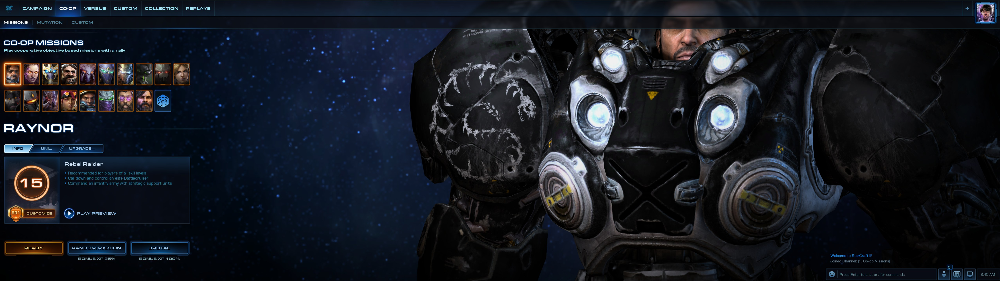
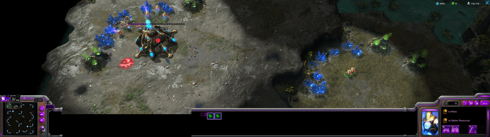
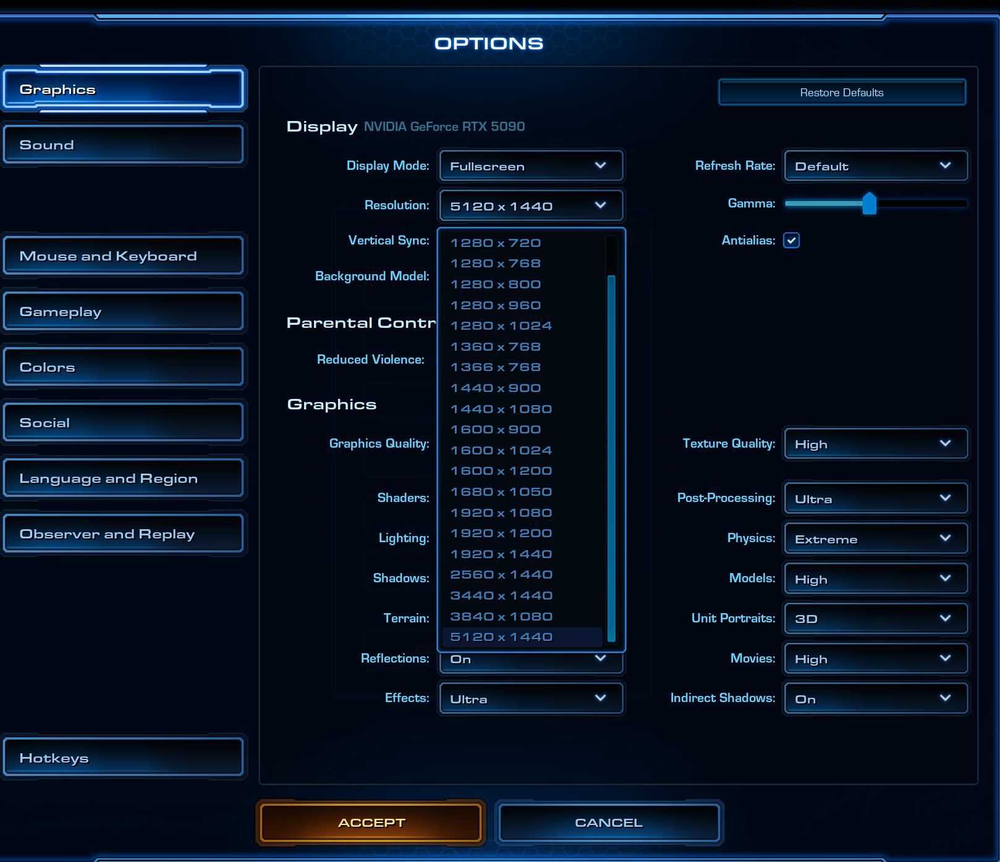

# 星际争霸2 超宽屏补丁（21:9 / 32:9）

[English](README.md) · **中文**

## 一行安装

1. **先退出游戏**（关掉战网，或在战网里退出星际争霸2）。游戏进程必须退干净：进程还在的话，游戏文件被 Windows 占用，补丁写不进去。
2. **打开 PowerShell**：按 Windows 键，输入 `PowerShell`，回车。
3. **把这一行粘进去，回车**：

```powershell
Invoke-WebRequest -Uri 'https://raw.githubusercontent.com/zhubaohi/SC2-Ultrawide-patch/main/sc2-ultrawide.ps1' -OutFile "$env:TEMP\sc2ulw.ps1"; powershell -NoProfile -ExecutionPolicy Bypass -File "$env:TEMP\sc2ulw.ps1" apply
```

4. 看到 `Read-back check: all patches in effect` 就成了。从战网启动游戏，在 **选项 → 视频** 里选中你的超宽分辨率。

这一行就是全部安装过程：自动把脚本下到临时目录、打好补丁、写好游戏配置，不用自己去下文件。

---

星际争霸2 在窗口化模式下死活不肯超过 16:9，所以在 21:9、32:9 的屏幕上看，
游戏就像桌面正中间夹着黑边的一条。这个补丁改动的是游戏程序里几处写死的限制，
让引擎在窗口化全屏下接受你的超宽分辨率。

- 纯 PowerShell 实现，目标机器只要系统自带的 PowerShell 5.1，什么都不用装。
- 动手改文件之前先自动备份，一条命令就能还原。
- 按字节自动识别游戏版本，版本不对直接拒绝，绝不会留下改了一半的文件。
- 支持往正在运行的游戏里直接注入（支持的版本），不用重启。

> **致谢**：本作品是在 [NGA 这篇帖子](https://bbs.nga.cn/read.php?tid=47835650) 的原创作品基础上完成的。

## 游戏内效果

5120 x 1440（32:9）屏幕上的实际效果：





<p align="center"></p>

## 一、系统要求

| 项目 | 要求 |
|------|------|
| 系统 | Windows 10 / 11（64 位） |
| 运行环境 | 系统自带的 PowerShell 5.1，无需额外安装 |
| 游戏版本 | 5.0.17.98310、5.0.15.98370 或 5.0.17.98370（自动识别） |
| 显示器 | 任意常用的 21:9 / 32:9 带鱼屏（3440x1440、5120x1440 等），或任意你指定的分辨率 |

先说两句：

- 版本不对时，工具会列出不符的字节并拒绝修改，不会有坏文件。
- 想移植到新版本，见 `docs/技术分析.md` 末尾的「版本适配指南」。

## 二、安装与游戏内设置

页面顶上那一行命令就是全部安装过程：脚本下载到 %TEMP%，立即打补丁，分辨率自动检测，
不用克隆仓库、不用额外文件。

打完后，游戏里保持这两个设置：

```
显示模式 = 窗口化全屏
分辨率   = 你的带鱼屏分辨率（如 5120x1440 / 3440x1440）
```

配置由补丁自动写入（桌面分辨率自动检测），一般不用手动改。

### 游戏没退出？不重启直接注入

把那一行命令末尾的 `apply` 换成 **`live`**：

```powershell
Invoke-WebRequest -Uri 'https://raw.githubusercontent.com/zhubaohi/SC2-Ultrawide-patch/main/sc2-ultrawide.ps1' -OutFile "$env:TEMP\sc2ulw.ps1"; powershell -NoProfile -ExecutionPolicy Bypass -File "$env:TEMP\sc2ulw.ps1" live
```

它把补丁直接写进游戏内存，游戏立刻按新尺寸重算窗口。
缺点是退出游戏就失效，下次启动得再跑一次；想一劳永逸就退出游戏用 `apply` 那行。

> **5.0.17.98310** 特别注意：这个版本的标签字符串和宽高比常量在只读页（`.rdata`）上，
> 引擎运行时保护这些内存，没法完整注入。`live` 会在写任何字节之前就检测到这一点并明确拒绝
> （零写入、不留半补丁）。这时候请退出游戏，用 `apply` 那行（文件补丁），
> 这是 98310 的可靠路子。详见 `docs/技术分析.md` 第十节第 4 小节。

### 游戏里验证（apply 之后）

1. 启动游戏，打开 **选项 → 视频**。
2. 分辨率下拉表顶部必须出现 6 个新的带鱼屏选项：
   `2560x1080`、`3440x1440`、`5120x1440`、`3840x1600`、`5120x2160`、`3840x1080`。
3. 选中 **5120x1440**，显示模式设为**窗口化全屏**。
4. 窗口应铺满整个 5120x1440 桌面（32:9 边到边）。

如果窗口被夹回 16:9，见下方常见问题。

## 三、参数

```powershell
.\sc2-ultrawide.ps1 [status|apply|revert|live|help] [-Exe <路径>] [-Config <路径>] [-Width N] [-Height N] [-DryRun]
```

| 参数 | 说明 |
|---|---|
| `-Exe <路径>` | 手动指定 `SC2_x64.exe`（自动查找失败时用） |
| `-Config <路径>` | 手动指定 `Variables.txt` |
| `-Width` / `-Height` | 目标分辨率。省略的话自动检测主显示器（须为内置的 21:9/32:9 选项之一，检测失败时回退 5120x1440） |
| `-DryRun` | 只演练不写入 |

比如：

```powershell
.\sc2-ultrawide.ps1 apply -Width 3440 -Height 1440
.\sc2-ultrawide.ps1 apply -Width 2560 -Height 1080
```

> 引擎把分辨率打包进 14 位字段，每轴上限 16383，超出的值会被拒绝。

## 四、它到底改了什么

三组改动，全是为了同一件事：把带鱼屏从写死的 16:9 限制里放出来。
每个版本一套补丁表（偏移各不相同），写之前逐点按字节校验，版本不符直接拒绝。

**1）分辨率下拉表：改写低档条目**

引擎的分辨率表写死 17 项（每项 24 字节：宽、高、标签头指针、标签尾指针）。
5120x1440 带鱼屏上用不到的低档条目（480p、640x480 这一类）被覆盖成常用超宽分辨率，
`3840x2160` 那档保留不动。下拉表仍是 17 项，游戏原有逻辑不受影响。

每格条目改 4 处：宽（4 字节）、高（4 字节）、标签字符串（16 字节，比如 `"@UI/480x360"`
变成 `"2560x1080"`）、标签尾指针（8 字节，跟随新字符串长度）。默认 6 格如下，
可以在 `sc2-ultrawide.ps1` 顶部的 `$UltrawideRes` 里自行增删（最多 6 项）：

| 条目（原分辨率） | 新分辨率 |
|---|---|
| 0（480x360） | 2560x1080 |
| 1（640x360） | 3440x1440 |
| 2（640x480） | **5120x1440** |
| 3（640x512） | 3840x1600 |
| 4（800x600） | 5120x2160 |
| 5（960x540） | 3840x1080 |

**5.0.17.98310**（本补丁默认适配的目标，条目 0~5 各 4 处，共 24 处）：

| 条目 | 宽 | 高 | 标签 | 标签尾指针 |
|---|---|---|---|---|
| 0 | `0x03920860` | `0x03920864` | `0x02E6F660` | `0x03920870` |
| 1 | `0x03920878` | `0x0392087C` | `0x02E6F670` | `0x03920888` |
| 2 | `0x03920890` | `0x03920894` | `0x02E6F680` | `0x039208A0` |
| 3 | `0x039208A8` | `0x039208AC` | `0x02E6F690` | `0x039208B8` |
| 4 | `0x039208C0` | `0x039208C4` | `0x02E6F6A0` | `0x039208D0` |
| 5 | `0x039208D8` | `0x039208DC` | `0x02E6F6B0` | `0x039208E8` |

**5.0.15.98370 / 5.0.17.98370**（旧版适配表，条目 0~3 各 4 处，共 16 处）：

| 条目 | 宽 | 高 | 标签 | 标签尾指针 |
|---|---|---|---|---|
| 0 | `0x3BD8090` | `0x3BD8094` | `0x2BF2700` | `0x3BD80A0` |
| 1 | `0x3BD80A8` | `0x3BD80AC` | `0x2BF2710` | `0x3BD80B8` |
| 2 | `0x3BD80C0` | `0x3BD80C4` | `0x2BF2720` | `0x3BD80D0` |
| 3 | `0x3BD80D8` | `0x3BD80DC` | `0x2BF2730` | `0x3BD80E8` |

**2）宽高比上限：浮点常量（98370 是 2 处，98310 放宽 3 处候选）**

引擎在 2 处写死了 16:9 的宽高比上限（约 1.7778f）。一处在**分辨率解析函数**，
宽高比超限的分辨率直接拒收；另一处在**窗口尺寸函数**，这一处才是关键：
窗口化全屏下窗口被夹回 16:9 的细条，D3D9 背景缓冲跟着窗口走，渲染分辨率也跟着被夹掉。
补丁把这些浮点改成按目标分辨率动态算的 `W/H + 0.05` 容差（5120x1440 算出 3.6056f）。

**3）画质预设门槛：1 条指令（仅 98370 系列）**

98370 的分辨率解析函数里有一条 `cmp reg, 5` 预设门槛（只有预设档 0~5 会走解析逻辑），
补丁把它改成 `cmp reg, 7`，自定义画质档也能解析分辨率。

**98310 没有这一处**：这个版本的 `.text` 段是密文（运行时解密加载，PE 入口点为 0），
指令级补丁没法落在磁盘文件上；而且静态穷尽扫描（13 处 `cmp reg,5` 全部校验过）
也没发现 98370 形状的门槛，推测源码里已经移除。所以 98310 的补丁表是 27 处纯数据站点
（24 处表条目 + 3 处浮点常量），见 `docs/技术分析.md` 第七、九节。

各版本函数/常量点的 RVA：

| 版本 | 解析上限（f32） | 预设门槛（cmp 5 到 7） | 窗口上限（f32） |
|---|---|---|---|
| 5.0.17.98310 | `0x02E7BC80` | 不适用（代码段密文） | `0x02FB72A0` + `0x02D06700` |
| 5.0.1x.98370 | `0x2BFC1D0` | `0x118125E` | `0x2C2A588` |

98310 的三个浮点候选（都是 16:9 类上限常量）全部放宽到 `W/H + 0.05`：
这样「解析上限」和「窗口夹取」两条路径都覆盖到了，就算某处没被代码引用也无害。

配置写入 `%USERPROFILE%\Documents\StarCraft II\Variables.txt`：

```
displaymode=1      # 0=窗口化 1=窗口化全屏 2=独占全屏
width=5120
height=1440
windowx=0
windowy=0
windowwidth=5120
windowheight=1440
```

完整推导过程（反编译证据、运行时取证方法、98310 适配记录）见 `docs/技术分析.md`。

## 五、还原

把那一行命令末尾的 `apply` 换成 **`revert`**：

```powershell
Invoke-WebRequest -Uri 'https://raw.githubusercontent.com/zhubaohi/SC2-Ultrawide-patch/main/sc2-ultrawide.ps1' -OutFile "$env:TEMP\sc2ulw.ps1"; powershell -NoProfile -ExecutionPolicy Bypass -File "$env:TEMP\sc2ulw.ps1" revert
```

备份文件在 `SC2_x64.exe.sc2uw.bak` 与 `Variables.txt.sc2uw.bak`。
也可以用战网客户端的「扫描与修复」恢复官方文件。

配置文件不会自动还原（分辨率设置本身无害），需要的话把备份里对应的行改回来。

## 六、常见问题

**问：提示「没有找到 SC2_x64.exe」**
用 `-Exe` 手动指定，路径一般在 `<安装目录>\Versions\Base98310\SC2_x64.exe`。
也可以先启动一次游戏，工具会读取游戏自己写的 `Documents\StarCraft II\ExecuteInfo.txt`。

**问：提示「该文件的字节与支持版本不符」**
游戏版本和补丁不匹配（多半是战网刚更新过游戏）。文件**没有**坏掉。
要么等补丁适配新版本，要么用 `revert` 那行命令或战网「扫描与修复」恢复官方文件。

**问：打完补丁，游戏里窗口还是没铺满**
1. 跑那一行命令（末尾加 `status`），确认所有补丁点都是 `patched`；
2. 确认游戏里「显示模式」是**窗口化全屏**（不是「全屏」，也不是「窗口化」）；
3. 确认 Windows 显示设置里桌面分辨率就是 5120x1440（单块 32:9 屏，或两块 2560x1440 拼接）。

**问：为什么不新增一项，而是改低档条目？**
分辨率表写死 17 项，内存里旁边紧挨着其它数据，没法原地加长。低档条目（480p 这一类）
在 5120x1440 带鱼屏上本来就用不上，改它们对正常使用零影响；`3840x2160` 那档原样保留。

**问：战网更新或「扫描与修复」之后失效了？**
正常的，更新会覆盖 `SC2_x64.exe`。重新跑 `apply` 那行命令就行（新版本可能需要重新适配）。

**问：会被反作弊检测吗？**
`apply` 那行命令只改本地可执行文件的静态字节，不写内存、不注入进程，风险最低。
`live` 会写游戏进程内存，如果在意的话请优先用 `apply` 那行。

## 七、文件清单

```
sc2-ultrawide.ps1      主程序（status / apply / revert / live，双版本自适应）
README.md              英文文档
README.zh-CN.md        本文件（中文）
screenshots/           游戏内截图（5120x1440）
docs/技术分析.md        技术分析：根因、补丁表、取证过程、98310 适配、版本适配指南
```

## 八、免责说明

补丁针对单机/菜单与本地客户端行为，改的只是本地文件。动手之前已自动备份，随时可以还原。
游戏版本更新后需要重新适配。

**作者对使用本补丁导致的任何后果概不负责（包括封号）。** 使用本修改即代表你完全
自行承担风险（账号、文件、硬件）。
